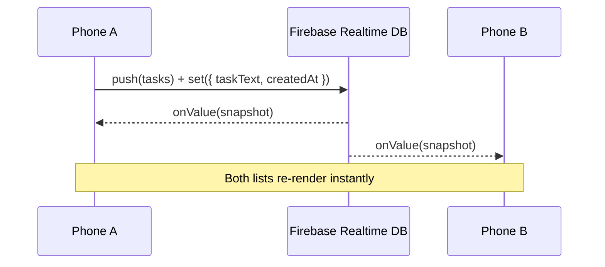

<div align="center">

# 🔥 Firebase Realtime Tasks

**A React Native task manager that syncs live across devices through Firebase Realtime Database.**


</div>

---

## Overview

Add a task on one phone and it shows up on every other open device straight away, with no refresh and no polling. The app is a compact example of **real-time CRUD** on a cloud database from a mobile client.

## Features

- ➕ **Create** tasks with a Firebase-generated unique key (`push`) and a server timestamp (`serverTimestamp`)
- 📡 **Read in real time** with an `onValue` listener, which updates the list the moment data changes. It unsubscribes on unmount to avoid memory leaks.
- ✏️ **Update** a task in place, with an edit mode that reuses the same input field
- 🗑️ **Delete** with a confirmation dialog
- ✅ **Validation and feedback**: empty tasks are rejected and every operation reports success or failure

## How the data flows



Data shape in the database:

```json
{
  "tasks": {
    "-Nx3kQ...": { "taskText": "Finish lab report", "createdAt": 1731920000000 }
  }
}
```

## Tech stack

React Native · Expo · Firebase JS SDK (modular v12) · `@expo/vector-icons`

## Getting started

**Prerequisites:** Node.js 20 or later, the Expo Go app on your phone (or an emulator), and a Firebase project with **Realtime Database** turned on.

```bash
git clone https://github.com/mahamed7/firebase-realtime-tasks.git
cd firebase-realtime-tasks
npm install
cp .env.example .env      # paste your Firebase web config values
npx expo start            # scan the QR code with Expo Go
```

## Security note

Firebase web config values (`EXPO_PUBLIC_*`) are bundled into the app and are **not secrets**. What actually protects the data is **Realtime Database security rules**. For anything beyond a demo, require authentication, for example:

```json
{
  "rules": {
    "tasks": {
      ".read": "auth != null",
      ".write": "auth != null"
    }
  }
}
```

## Roadmap

- [ ] Firebase Authentication with per-user task lists
- [ ] Mark tasks complete, and filter by status
- [ ] Offline persistence and optimistic updates

## Author

**Saabir Dahir Mahamud** · [Portfolio](https://mahamed7.github.io/Portfolio/) · [GitHub](https://github.com/mahamed7)

Released under the [MIT License](LICENSE).
